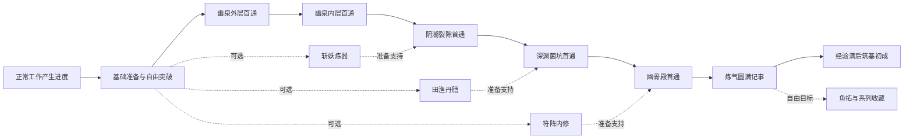

# 22 玩家路线与内容节奏

> 本页定义扩展版本的玩家路线，不是发布状态或实测进度报告。规则/配方/倍率以`02_systems.md`为唯一来源，操作体验见`16_subsystem_deepening.md`；机器可检查的门槛与路线索引见`23_deepening_routes.json`。实施、验收与发布记录只在`10_todo.md`。

## 1. 一条主线，三种准备方式

主线是“理解输入→稳定准备→逐区首通→炼气圆满→筑基初成”。三支线提供准备风格，不增加职业选择或排他解锁。玩家每次回来只需要回答：这次准备解决什么问题？

虚线表示支持关系，没有做过支线仍可推进全部区域。图中箭头只代表先后内容，不代表必须使用前一节点的专属掉落制造下一节点的必需品。

## 2. 解锁与教学顺序

活动解锁沿用`ProgressiveUnlockRules`，不将教学目标塞入额外硬门槛。同一次境界提升有两种新活动时先推荐最贴近当前缺口的一种，另一种留在活动列表，不要求立即学习。

| 境界波次 | 可用活动 | 本波只教学一个核心概念 | 推荐操作 | 不要求 |
|----------|----------|------------------------|----------|--------|
| realm1 | 副本、修炼、炼丹 | 工作产生进度；进度不是点击游戏界面赚来的 | 平衡修炼、一次基础回气丹、手动突破 | 立即打Boss、购买高价商品 |
| realm2 | 再加灵田、矿脉、坊市 | 为目标找材料；真实时间作物会独立长成 | 缺药种灵草，缺装备采寒铁，任选先学 | 种满田、两系统精通同时升级 |
| realm3 | 再加炼器、灵渔 | 从材料到确定性成品 | 寒铁自制或定向食材，比较后装备 | 随机掉好武器、买高阶鱼塘许可 |
| realm4 | 再加烹饪、符箓 | 一次挑战只准备有用的增益 | 家常汤或Boss用符；看触发理由 | 四膳全做、所有符都带 |
| realm5 | 再加阵法、体修 | 长期基础与当前方案的区别 | 一主阵或有限训练，再看双阵/姿态 | 11系统全精通、长期维持Buff |

新玩家默认推荐平衡修炼，允许直接选择副本；首开先解释正常工作如何推进，再展开当下操作。首次完成制作比“首小时打赢Boss”更适合作为可感知反馈。初次提示不占输入焦点，体验包与目标奖励均须一次性幂等。

**时间口径**：解锁以事件/境界为准，不承诺按固定天数完成。有效输入、AP和活跃分钟分别记录；安静阅读不是停滞惩罚。不能把首日60–90分钟第3境当作已证明指标。基础事件到达估算和试玩目标见`03_progression_and_balance.md`深化预算。

## 3. 主线目标

| 目标ID | 玩家目标 | 完成事件 | 推荐准备与退路 |
|--------|----------|----------|----------------|
| `route_start` | 明白正常工作产生收益 | 首次有效输入后看见一次资源/进度更新 | 可跳提示，采集暂停时说明原因 |
| `route_first_prepare` | 理解制作和消费 | 制作或购买一次基础回气丹 | 初次补给按02§24.2；也可通过副本/坊市自给 |
| `route_clear_001` | 首通幽泉外层 | 主动击败`lv_qi_001` Boss | 推荐realm3左右、基础恢复与可用装备；可以更早挑战 |
| `route_clear_002` | 首通幽泉内层 | 主动击败`lv_qi_002` Boss | 推荐realm4左右；输出不足先看武器继承后差值，生存不足看恢复 |
| `route_clear_003` | 首通阴潮裂隙 | 主动击败`lv_qi_003` Boss | 推荐realm5–6；主线装备或分支准备任选 |
| `route_clear_004` | 首通深渊菌坑 | 主动击败`lv_qi_004` Boss | 推荐realm7–8；回血威胁可用抑生丹或镇灵符，亦可直接提升输出 |
| `route_clear_005` | 首通幽骨殿 | 主动击败`lv_qi_005` Boss | 推荐realm9；复用一套可完成准备链，不临门要求全部系统 |
| `route_qi_complete` | 回看炼气圆满 | 五区首通标记齐全 | 记录实际玩法路线与代表物，不检测图鉴100% |
| `route_foundation` | 筑基初成，收束境界线 | realm9经验满且五区首通，玩家手动跨至realm10 | 不消费稀有材料，不要求购买突破丹 |

前两个目标是可跳过的教学记录，不是Boss或突破的门锁。唯一硬主线门锁为区域链首通与基础大境界规则；“推荐准备达标”不等于必需装备评分。

## 4. 五区分别教会什么

| 区域 | 内容主题与敌人 | 首次挑战要理解 | 首通后的深造 | 下一步如何改变 |
|------|--------------|----------------|--------------|----------------|
| `lv_qi_001`幽泉外层 | 苔藓、洞蛛、蛛后 | 手动装备、恢复阈值、挑战由玩家决定 | 定向讨伐、强化继承入口、灵圃饮解锁标记 | 可以为一个材料目标回访，不必盲刷 |
| `lv_qi_002`幽泉内层 | 暗影蝠王、先手威胁 | 比较先手与生存准备，不只比较攻击 | 灵盾丹、寻踪阵盘解锁标记 | 可用护盾或探索阵解决不同目标 |
| `lv_qi_003`阴潮裂隙 | 幼蛇、阴潮蛇 | 多个准备来源任选，不收集所有增益 | 抑生丹、镇灵符解锁标记 | 为下一地区提供两条阻断回血路径 |
| `lv_qi_004`深渊菌坑 | 孢子、真菌巨兽、回血威胁 | 对策能缩短战斗，普通强化仍可通关 | 完整记录回血敌人观察与已用方案 | 在终区复用方案，少学新系统 |
| `lv_qi_005`幽骨殿 | 骨仆、骨王、护甲与生存压力 | 在已有工具里做取舍 | 炼气圆满与收藏目标 | 主线有句号，不再加突发材料税 |

区域特征来自现有怪物家族，扩展只补威胁配置与观察记录。普通怪、Boss威胁、道具识别和离线战斗必须共用同一标签；新异常效果不先于敌人机制单独上线。

## 5. 三条可切换支线

### A：斩妖炼器——把战力做成确定性目标

副本看缺口 → 稳采寒铁 → 自制或保留掉落装备 → 小段强化 → 换装继承 → 再挑战。材料目标来自真实目标装备及已有投入，不追求全套满强化。

- 首次体验只用基础矿点、炼器Lv1与普通材料；强化碎片不足可选尾矿回收。
- 推荐先选炼器Lv2，再按材料需求选矿脉/副本Lv2；早期推荐组合总悟性85，来自现有三项Lv2成本，不是入路费用。
- 代表成果是“自制一件、继承一次、用这件装备过一位Boss”，而不是收集所有系列。
- 阵法、体修、烹饪不必全练；准备品可由基础炼丹或坊市供给。

### B：田渔丹膳——按工作节奏安排补给

配田保种 → 按食谱定向钓食材 → 家常灵膳体验 → 选供气/悟性/生产效果 → 战术丹只对目标威胁使用 → 挑战后回看实际消费。

- 灵田不抢主输入管道，灵渔只在缺食材时成为主行为；不能“钓鱼与炼丹同时1倍推进”。
- 推荐灵田、灵渔、烹饪、炼丹Lv2组合总悟性95；高级鱼塘许可和灵果不是入路费用。
- 代表成果是“一次布局支持一轮丹膳准备，用预设控制消耗”。
- 通关仍要基础装备，可用确定性自制补缺；不要求炼丹Lv4、灵渔Lv4或全部四膳。抑生丹只是高级对策之一。
- 家常汤先做一次体验；悟性已足够下一目标时不建议每位Boss前重做。作物收获、膳食和战术丹按当前缺口准备，不能以“维持全部增益”为支线完成条件。

### C：符阵内修——少量针对性物品加长期基础

平衡修炼补经验 → 符箓匹配当前威胁 → 一个主阵提供稳定支持 → 有限体修计划 → 二选一姿态 → 需要时才尝试主副组合。

- 推荐修炼、符箓、阵法、体修Lv2，另列矿脉Lv2作为护体阵旗的灵玉稳定来源，合计悟性145；先选当前缺口最相关的一项。已有灵玉可先做阵，不必重复学习材料来源。
- 首个主阵推荐护体阵旗，不要求先学灵渔Lv3取龙涎制作聚灵阵；双阵Lv3是额外构筑空间，灵果未解锁时可选铁骨功。
- 代表成果是“看懂威胁、保存一个方案、同一方案至少回用一次”。
- 镇灵符与抑生丹提供替代解，不能把同时制药做符当必修。
- 符料或兽骨不足时允许跳过该次可选准备，以基础强化/恢复及更高推荐境界挑战。限量回访没有结果就保留目标到以后，不无限刷料；预算模型最多额外尝试10个遭遇机会，此为分析策略，不是运行时自动化或新硬门槛。

三组合预算按当前精通成本计算，后续改成本应由结构校验报差异。成长越快不等于必须改走另一条；完成一个分支体验后仍保留全部入口与投资。

## 6. 同一条主线的最低准备路径

以修炼/副本/基础丹药和基础炼器为核心，矿脉仅为固定装备及碎片兜底提供材料：

1. 境界经验不足时平衡修炼；不要求买任何精通才允许小突破。
2. 无合用武器时基础寒铁矿→基础自制武器；无需稀有装备掉落或区域后置配方。
3. 先用低强化段，必要时只购炼器Lv2提升到当前武器可达的中段；不用额外解满其他系统。
4. 回气丹来自基础配方或基础坊市；缺草可副本采集、灵田补给或买基础成品。
5. 按失败诊断选择再补输出、生存或境界；只有真实战斗结果通过才认为路线成立。

这是扩展版本必须验证的最低路径规格，不能把文档图的可达性当成已经验证的通关。数值验收要包含最差合理掉落序列、无稀有物、不开双倍符、无高阶鱼塘、低活跃输入；若不通，优先降低区域硬墙或补基础来源，不能新增必练支线。

最低战斗基线：realm3/4/6/8/9，保留初始武器与护甲，第三区前只强化武器到+3，备基础回气丹。制造可替换初始武器，但不是通关条件；基础制造武器攻击主属性规则见02§24.6。第四区realm7阻断方案可提前挑战，realm8无需阻断；第五区破甲降低回合数，未制符仍可通关。

完整预算区分85/95/145悟性的精通消费与全部准备成本。72组常规样本和4组零随机副本材料压力样本的模型数据见`26_route_balance_analysis.md`；其中包含扩展操作的设计模拟，不代表完整原生游玩验证。最低路线不要求任何精通升级；三支线多投入的成本换准备风格，不能宣称每条都更快或更省操作。

## 7. 回看、停止与回归

每次30–90秒管理流程：收下回归卡 → 看唯一主目标与差一项什么 → 任选解决方式 → 确认输入/材料预算 → 关书工作。完成目标只静默记事，不自动装备、不花钱，不抢焦点展开下一教学。

已有目标完成后保留成果，推荐下一步不自动执行。配方缺料、矿点耗尽、鱼塘容量不足时显示具体原因和一个有来源的替代动作；可选回平衡修炼，绝不未经允许购买刷新或高价种子。

离开一周后仍能恢复路线：作物无过熟、已有解锁不撤回、无连续签到重置。离线结果按真实能力区分资源、完成批次、待收获和冻结原因；在线主动Boss首通不由离线跳过。

## 8. 内容扩展检验

- 新方至少有明确的使用目标，不能仅为收集而需要先付高额成本。
- 首次制作的每种材料在解锁前可获得，且至少有一种确定性或可预算的基础来源；新方不用自己的产物作为前置。
- 每个新增威胁至少允许“现有基础成长”与“一种可选对策”两个解法，不能锁唯一流派。
- 解锁高级配方后仍有一种低阶操作值得回用；不用同时取全网材料。
- 终点后的收藏不反过来成为主线门槛；只预告下一项可能解锁，不一次展示全部未开放内容。
- 图结构和ID校验由`python tools/design/validate_deepening.py`完成；战斗、经济与30–90秒体验需后续专项试玩，验收状态只记于`10_todo.md`。
